# Anthony Serojales — portfolio

Personal portfolio site for Anthony Serojales, a software developer in the Philippines: HR by
role, developer by practice. Built with SvelteKit, fully prerendered, in light and dark themes.

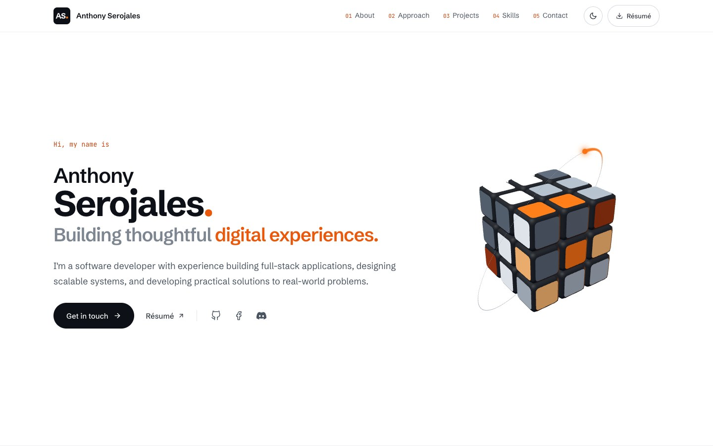

## Sections

|                                                                                                       |                                                                                |
| ----------------------------------------------------------------------------------------------------- | ------------------------------------------------------------------------------ |
| 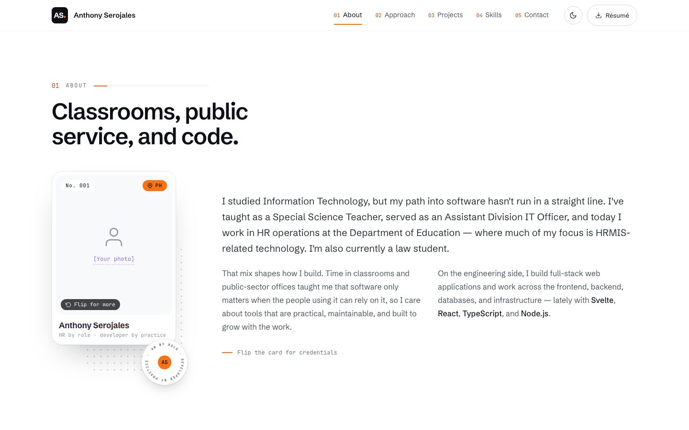                                                                  | 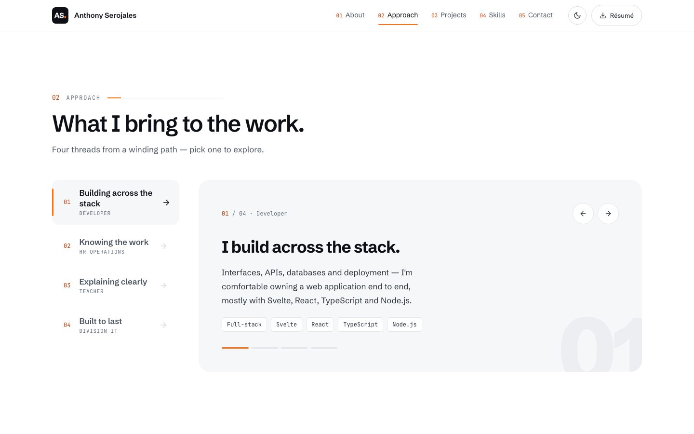                                     |
| **About** — a holographic photo card that tilts and flips to show credentials.                        | **Approach** — four threads from a winding path, as keyboard-accessible tabs.  |
| 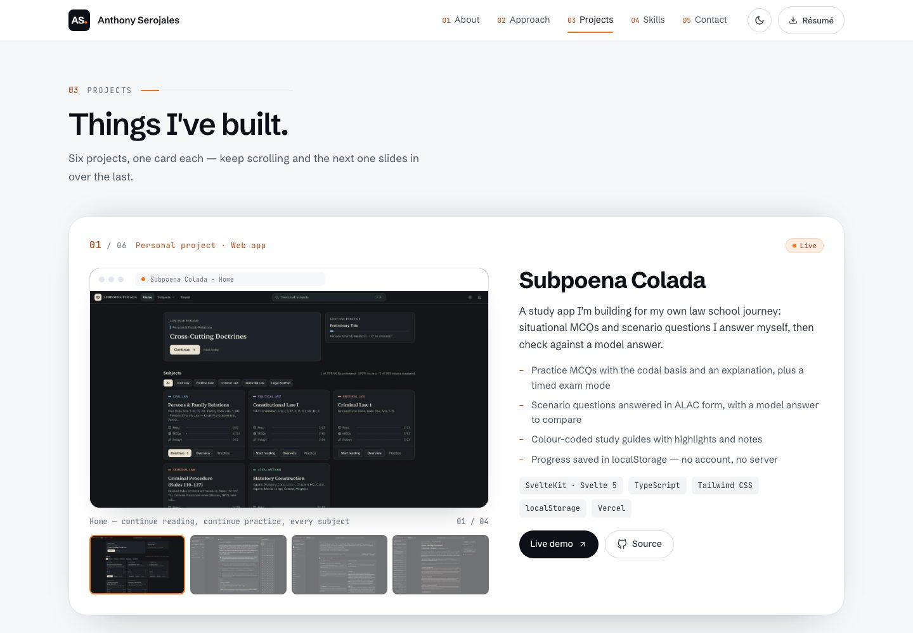                                                            | 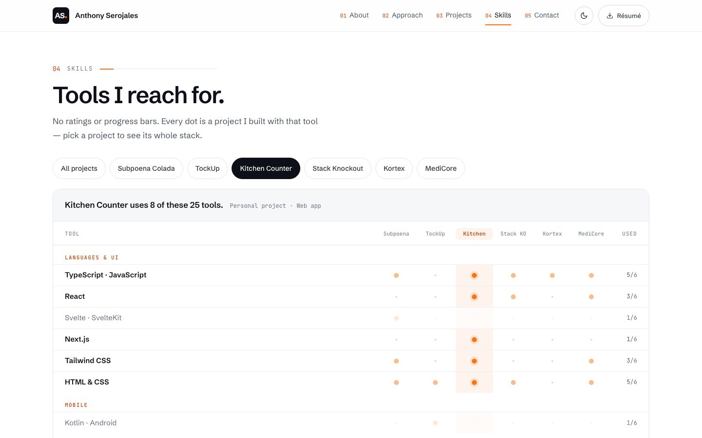                                         |
| **Projects** — a sticky card deck; each card has screenshots, phone views or an architecture diagram. | **Skills** — a tools × projects matrix; pick a project to see its whole stack. |
| 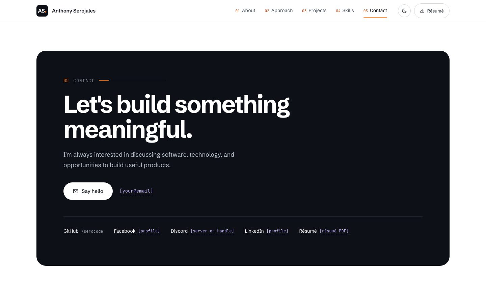                                                              | 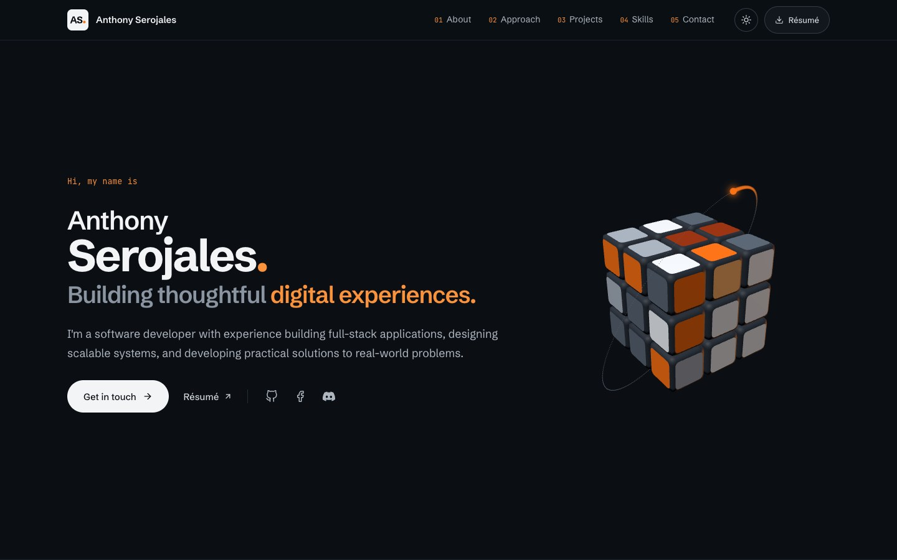                            |
| **Contact** — the one inverted panel on the page.                                                     | **Dark theme** — follows the OS, remembers the visitor's choice.               |

### Phones

|                                                      |                                                              |                                                            |
| ---------------------------------------------------- | ------------------------------------------------------------ | ---------------------------------------------------------- |
| 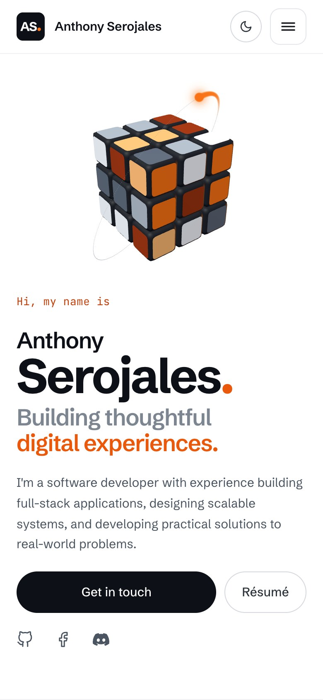 | 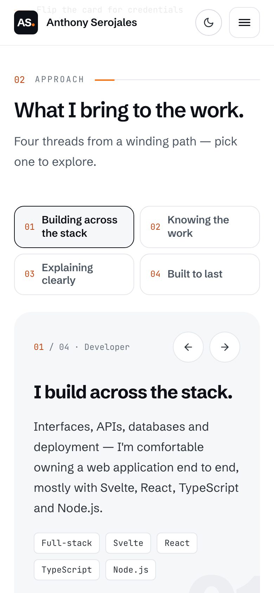 | 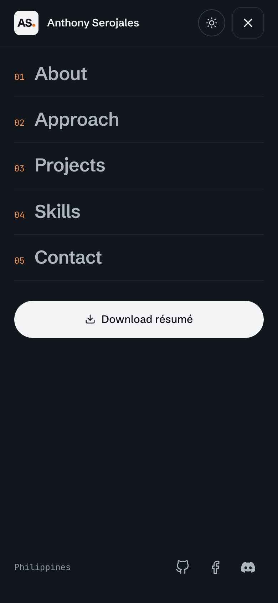 |

### Loading and theme switch

|                                                                      |                                                                     |
| -------------------------------------------------------------------- | ------------------------------------------------------------------- |
| 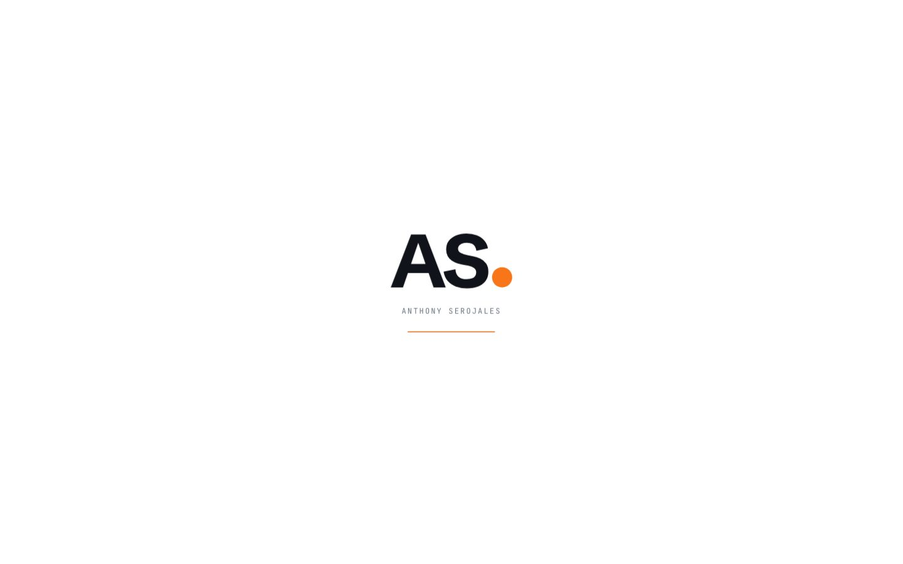                         | 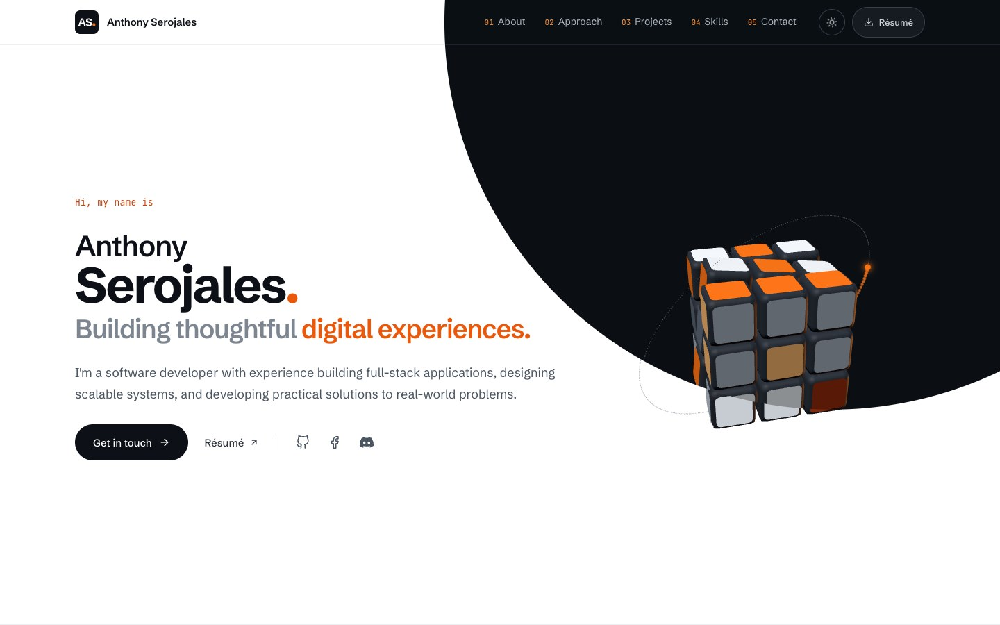                  |
| **Intro loader** — "AS." with a landing full stop, once per session. | **Theme switch** — the new theme grows as a circle from the toggle. |

## Features

- **Full-screen sections** that snap under the sticky header; taller sections scroll freely.
- **3D hero** (three.js): a self-solving 3×3 Rubik's cube with a dotted orbit ring and comet,
  loaded off the critical path, paused when off-screen, recoloured per theme.
- **Dark theme** driven entirely by design tokens, set before first paint (no white flash).
- **Loading states:** an intro loader on the first visit of a session (skipped for reduced motion
  and without JavaScript), skeletons for the 3D hero and every screenshot while they load, and quiet
  fallbacks when an image or the 3D scene fails. Image boxes are reserved, so nothing shifts.
- **Touch-friendly:** swipe through project screenshots, drag or tilt the phone to tilt the photo
  card, and a sticky project deck that works on phones too.
- **Accessible:** semantic landmarks, one `h1`, visible focus, 44px touch targets, keyboard support
  for every control, `prefers-reduced-motion` respected throughout, and axe checks in both themes.

## Stack

SvelteKit 2 · Svelte 5 (runes) · TypeScript (strict) · Tailwind CSS v4 (utility classes only) · three.js ·
Playwright + axe-core · Biome · `@sveltejs/adapter-vercel` · pnpm

## Getting started

Requires a current Node.js LTS and pnpm.

```sh
pnpm install
pnpm dev            # http://localhost:5173
```

| Command                       | What it does                                                               |
| ----------------------------- | -------------------------------------------------------------------------- |
| `pnpm dev`                    | Dev server with hot reload                                                 |
| `pnpm build` / `pnpm preview` | Production build (prerendered) and a local preview of it                   |
| `pnpm check`                  | Type-check (svelte-check)                                                  |
| `pnpm lint` / `pnpm format`   | Biome lint + format check / apply formatting                               |
| `pnpm test`                   | Playwright smoke + accessibility tests on desktop and phone (builds first) |
| `pnpm og`                     | Re-render the social preview image, `static/og-image.png`                  |

## Editing content

All copy and data live in `src/lib/content/` — components never hard-code text:

| File          | Holds                                                     |
| ------------- | --------------------------------------------------------- |
| `site.ts`     | Name, hero copy, links, socials, email, résumé, site URL  |
| `about.ts`    | About paragraphs and the photo card                       |
| `approach.ts` | The four Approach topics                                  |
| `projects.ts` | Project cards: copy, badges, links, screenshots, diagrams |
| `skills.ts`   | The skills matrix                                         |

Anything not supplied yet is a `missing('[…]')` value, rendered as a violet placeholder so it can't
be mistaken for real content. Before launch, fill these in `site.ts`: the site URL (needed for
absolute social-preview links), email, résumé PDF, and the Facebook, Discord and LinkedIn links.
To add a photo, put it in `static/images/` and set `site.photo`.

## Project structure

```
src/
  app.css, app.html        tokens (@theme), global styles, no-flash theme + loader script
  routes/                  +layout (fonts, loader) and +page (the sections)
  lib/
    sections/              Hero, About, Approach, Projects, Skills, Contact
    components/            header, footer, cards, toggles, loader, small UI pieces
    actions/               deck scroll, sticky fit, tilt, swipe, image loading state, active nav
    content/               all copy and data
    styles/                dark theme tokens + theme-switch transition (the only CSS besides app.css)
    ui.ts                  shared Tailwind class lists (content column, buttons, image frames)
    three/                 the hero scene
    brand/                 the "AS." logo as outlined paths
static/                    icons, social image, project screenshots
tests/                     Playwright smoke + axe tests
docs/screenshots/          the images in this README
```

## Deployment

Deployed on Vercel with `@sveltejs/adapter-vercel`; every page is prerendered at build time.
`docs/` is excluded from deployments (`.vercelignore`).
